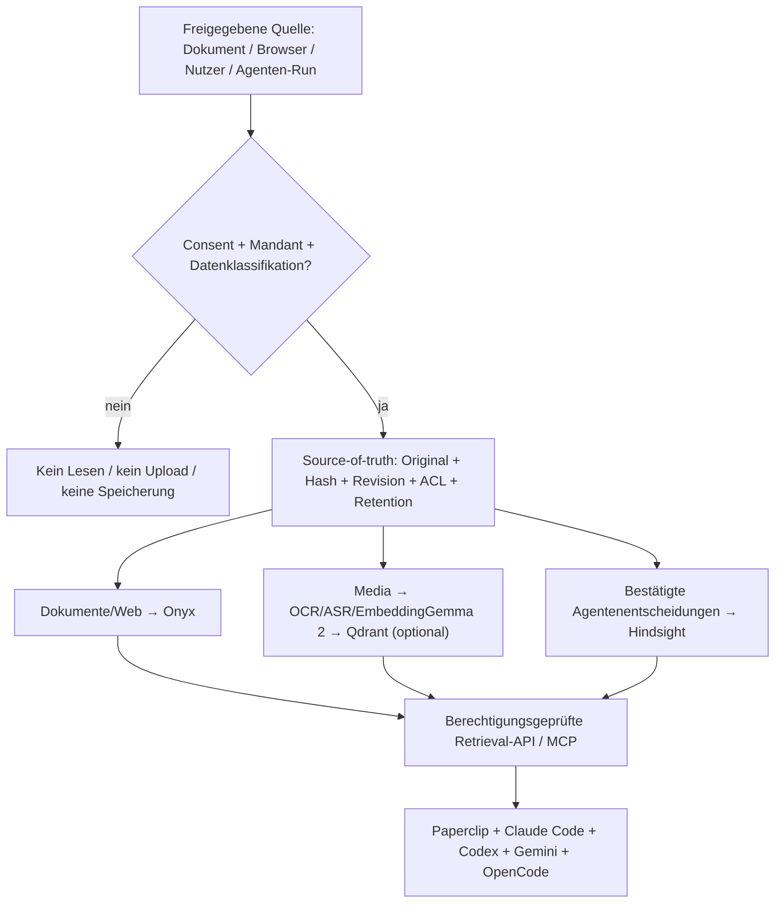

# Paperclip Universal Agent Stack — Architekturentscheidung (2026-10-17)

> Status: **Zielbild / Integrationsvorschlag**, kein Nachweis einer laufenden Produktivinstallation. Änderungen und Provider-Claims müssen an der tatsächlich installierten Version überprüft werden.
>
> Kanonische, **öffentliche, secret-freie** Systemübersicht für die Agenten- und Installer-Repositories. Produktspezifische Policies, kundenspezifische Konfigurationen und Abnahmebelege bleiben in den jeweiligen **privaten** Repos.

## Entscheidung: ein Control Plane, zwei klar getrennte Gedächtnisse

| Rolle | Primärsystem | Wann hinzufügen / vermeiden |
|---|---|---|
| Orchestrierung, Companies, Tasks, Runs, Budgets und Freigaben | [Paperclip](https://github.com/paperclipai/paperclip) | **Einzige** Agenten-Control-Plane; kein zweiter Swarm-Orchestrator |
| Ausführung | Native Paperclip-Adapter/Runner + freigegebene Codex-, Claude-Code-, Gemini-/OpenCode-Harnesses | Echte Host-/VM-E2E vor „ready“. Keine Cloud- oder Desktop-Fähigkeit stillschweigend behaupten |
| Persistentes **Agenten-Memory** | [Hindsight](https://github.com/vectorize-io/hindsight), Paperclip-Plugin | Entscheidungen und Erfahrungen; **keine** Originalquellen- oder Media-DB |
| Dokumente, Wikis, Apps, Enterprise-Retrieval | [Onyx](https://github.com/onyx-dot-app/onyx) | Eigenes Such-Backend verwenden; nicht dieselben Textquellen parallel in Qdrant duplizieren |
| Aktive Web-Archivierung / Bookmarks | [Karakeep](https://github.com/karakeep-app/karakeep) | Capture nur nach bewusster Nutzerfreigabe, mit kanonischen URLs und Duplikatkontrolle |
| Browser-/Desktop-Aktion | [OpenCLI](https://github.com/jackwener/OpenCLI) und separate native Computer-Use-Bridge | Autorisierter Host, Nutzer-Login, Replay/Receipts, keine verteilten Cookie-/Token-Kopien |
| Multimodale Dokumente | [RAG-Anything](https://github.com/HKUDS/RAG-Anything) **oder** eigener Router mit Docling/MinerU/PaddleOCR | Optional und nur bei nachgewiesenem Bedarf, nicht drei Parser blind für jede Datei |
| Fotos, Audio, Video → Embeddings | [EmbeddingGemma 2](https://huggingface.co/google/embeddinggemma-2) | **Optionaler eigener** Medien-Index [Qdrant](https://github.com/qdrant/qdrant); ersetzt keine OCR, ASR oder Diarisierung |
| Ein gemeinsamer KI-Zugang | Paperclip-/Onyx-/Hindsight-MCP; optional [IBM ContextForge](https://github.com/IBM/mcp-context-forge) | Gateway erst bei mehreren Zugriffspunkten/Policies; Auth vor Tool-Aufruf, nicht nur „geheime URL“ |
| Quelle der Wahrheit | Versionierte Originale + Metadaten/ACL in PostgreSQL/Objektspeicher oder Git | Suchindizes und generierte Memories **sind ersetzbare Ableitungen** |

**Nicht automatisch installieren:** Supermemory, Mem0, Graphiti, Cognee, LightRAG, weitere MCP-Gateways oder einen zweiten RAG-Stack. Als Vergleichskandidaten nur mit messbarem Vorteil und klarer Lizenzprüfung.

## Datenfluss & Verantwortlichkeit

- Ein **MCP-Server erzeugt keine automatische Chat-Aufzeichnung**. Agent-Hooks, sichtbare Exporte oder ausdrücklich aktiviertes Capture sind getrennte Mechanismen.
- Hindsight-Plugin kann **nicht pauschal** als vollständige Run-Archivierung gelten: Retain-/Recall-Verhalten, `agent.run.finished` und Bank-Zuordnung pro installierter Version prüfen.
- Geteiltes Projektwissen ≠ persönliches/mandantenweites Gedächtnis: explizites Mapping von `tenant/company/project/agent`, niemals eine globale gemeinsame Default-Bank.
- OCR/ASR extrahiert wörtliche Belege; Embeddings liefern Ähnlichkeit; ein LLM formuliert Antworten **mit Originalquellen und Revisionen**, niemals nur auf Basis eines semantischen Vektors.

## Schnittstellenvertrag für Adapter (Vorschlag)

Jeder Aufruf trägt eine **serverseitig bestätigte** `principal_id`, `tenant_id`, `company_id`, `purpose`, `trace_id` und `policy_version`. Der Client darf die Berechtigungsgrenze nicht durch freie Parameterwahl bestimmen.

| Interface | Wirkung / Beleg |
|---|---|
| `capture.request` | Vorschau + benötigte Freigabe; ohne Consent keine tatsächliche Inventur |
| `sources.ingest` | `source_id`, SHA-256, MIME, Revision, ACL und Erfassungsbeleg |
| `knowledge.search` | Auth-gefilterte `source_id` + Seiten-/Zeit-/Text-Locators, Rang, Suchpipeline |
| `sources.get` | Präzise Originalstelle **erneut autorisieren**, keine Volltexte in unberechtigten Memory-Kontext |
| `memory.recall` | Scope, Provenienz, Konfidenz und Aktualität zurückgeben |
| `memory.propose` / `memory.retain` | Nur freigegebene, rekonstruierbare Fakten/Entscheidungen speichern; Retain-Beleg |
| `privacy.revoke` / `privacy.delete` | Zugriff sofort sperren, Quellen/Embeddings/Caches/Memory nach Policy löschen und quittieren |
| `agents.run` | Paperclip-Task-/Run-IDs + konkrete Host-/Adapter-Abnahme; keine Nebenwirkung durch Research/Dateiöffnen |

## Git-Submodule: gezielt und gepinnt, **nicht überall blind**

- **Ja** für tatsächlich wiederverwendeten Code oder versionierte Agenten-Konfigurationspacks mit unabhängiger Release-Kadenz.
- **Nein** für Onyx, Hindsight, Paperclip, Karakeep, Qdrant usw. als Server/Services: diese per Deployment-Manifest und authentifizierter API anbinden, Versionen per Images/Digests fixieren.
- Bereits realer Integrationsfall: `servas-ai/radar:vendor/browser-voice-harness` → `servas-ai/browser-voice-harness` (bestehendes Submodul respektieren).
- Für den Agent Installer geeignet: `vendor/paperclip-fullstack-agent-swarm` als **gepinntes** Submodul dieses Repos, nur als opt-in Agent-Pack. Upgrades als eigener PR mit Prüfung von `.gitmodules` + Gitlink-SHA und `git submodule update --init --recursive`; **nie** automatisch auf `main` mitlaufen.
- App-Repos bekommen die kleine Integrationsnotiz und die **kanonische URL**, aber kein ganzes Agenten-Repo eingebettet, wenn es nicht direkt gebaut/gebündelt wird.
- Privater Quellcode darf nicht unbedacht als öffentliches Submodul/Link gespiegelt werden. Keine verschachtelten Submodule, wenn Paket/Release-Artefakt genügt.

## Sicherheits- und Abnahme-Gates

1. **AVV und konkrete Einwilligung VOR Scan/Capture**, soweit für das Produkt erforderlich; bei fehlender Freigabe 0 Lesezugriffe. Demo-Daten sind ausdrücklich markiert.
2. Login nur durch Nutzer/autorisierten Operator. **Keine Tokens, Cookies, Secrets, Kundenpfade oder Transkripte in Git, Logs, Memory oder Reports.** Sitzungen am berechtigten Harness-Host belassen; keine geteilten Abo-OAuth-Secrets auf Worker klonen.
3. Network-ACLs, verifizierte Identität, minimale Tool-Rechte, Egress-Limits, Audit- und Löschbelege; untrusted Webseiten/Prompt-Injection dürfen kein Write Tool freischalten.
4. Getrennte E2E: Paperclip Run/Receipt, Windows-/macOS-/Linux-Host, verifiziertes Agent-Tool, Browser, Memory nach Restart, zwei getrennte Companies, Delete/Revoke und Restore.
5. `ready` erst mit realem Receipt; Fehler rot mit Grund, „nicht getestet“/„unbekannt“ offen benennen. Kein erfundener Benchmark, Preis- oder Produktionsstatus.
6. Vor kommerziellem Bundling Lizenz, Modellgewichte, Copyleft, Dienstbedingungen und externe Datenübertragung pro Komponente prüfen.

## MVP-Reihenfolge & Entscheidungstore

1. Paperclip + isolierter CLI-Worker + Auth + Test-Task auf Testumgebung.
2. Hindsight-Plugin: `retain → neuer Run → recall` mit tenant-/company-isoliertem Test.
3. Onyx: eine echte freigegebene Quelle indexieren, Source-Locator und Delete prüfen.
4. Karakeep: freiwilliges Web-Capture, Deduplizierung, Originalnachweis.
5. Native Browser-/Desktop-Bridge: echte Windows/macOS-E2E, signierte Installer-/Berechtigungsbelege.
6. Erst nach Recall- und Retrieval-Benchmarks: multimodales OCR/ASR, EmbeddingGemma-2-/Qdrant-Index, optional MCP-Gateway.
7. Belastungs-/Speichertests für gleichzeitige Worker getrennt von Registrierungszahl.

## Zuständigkeit über Repositories

- **Hier**: wiederverwendbare Paperclip-Agenten und die anbieterneutrale Architekturentscheidung.
- **`servas-ai/agent-installer`**: optional gepinnter Agentenpack; Installer-Erkennung, Consent, Freigaben, echte Test-Receipts.
- **`servas-ai/radar`**: consent-gesteuerte Ist-Analyse, bestehender Browser-Voice-Harness-Gitlink bleibt unverändert.
- **`servas-ai/browser-voice-harness`**: Voice-MCP-/Transkript-Adapter, kein zentrales Memory, kein selbstständiges Speichern.
- **`fintaro-ai/fintaro-v2` / `fintaro-ai/fintaro`**: jeweilige Finanz-/Produktgrenzen, Quelle und Freigabe; keine automatische Buchung.
- **`fintaro-ai/fintaro-mcp`**: PII-arme, scopespezifische Finanzwerkzeuge; kein universeller Datenabfluss.
- **Weitere Fachrepos**: nur referenzieren, wenn die Schnittstelle benötigt wird.

## Nachweise / Quellen zum Abgleich

- [Paperclip Upstream](https://github.com/paperclipai/paperclip)
- [Hindsight Repo](https://github.com/vectorize-io/hindsight) und [Paperclip Integration](https://hindsight.vectorize.io/sdks/integrations/paperclip)
- [Onyx](https://github.com/onyx-dot-app/onyx), [Karakeep](https://github.com/karakeep-app/karakeep)
- [RAG-Anything](https://github.com/HKUDS/RAG-Anything), [EmbeddingGemma 2](https://huggingface.co/google/embeddinggemma-2)
- [Qdrant](https://github.com/qdrant/qdrant), [IBM ContextForge](https://github.com/IBM/mcp-context-forge)

**Scope:** Architektur-Dokumentation, kein Aktivieren von Capture, Installation, Credentials oder Live-Services durch diesen Commit.
